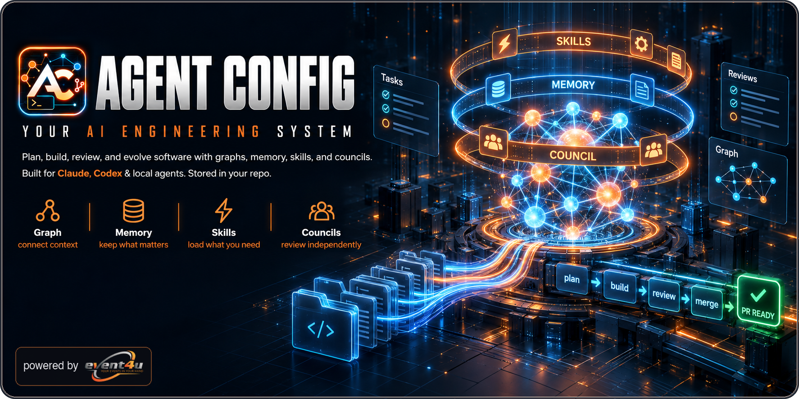
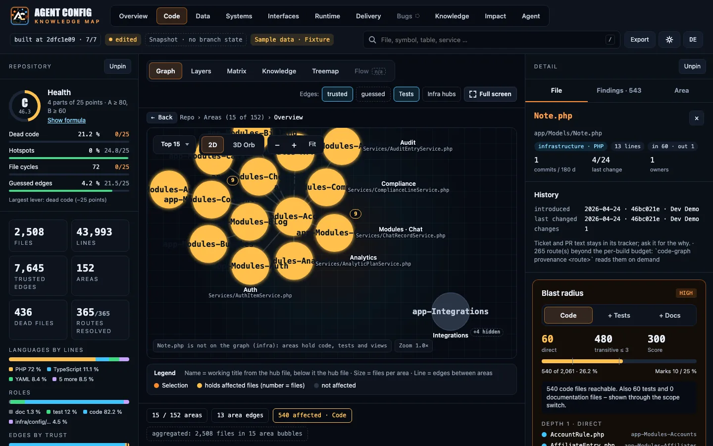
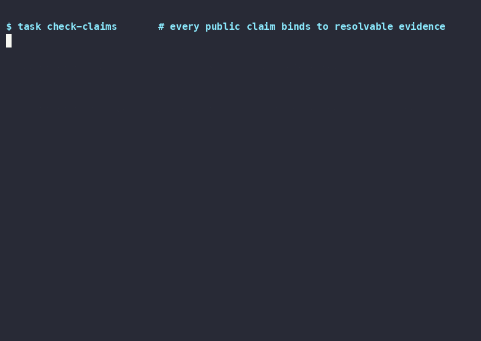

<p align="center"><a href="https://event4u-app.github.io/agent-config/"></a></p>

<p align="center"><sub>

Installs into your user-level AI tool configuration; your repository only gets an `agents/overrides/` folder for your own changes. Works with 20 AI coding tools<!-- claim:host-agent-count -->.

</sub></p>

# Agent Config — teach your AI coding agents to check their work before they say done

[](https://www.npmjs.com/package/@event4u/agent-config) [](https://www.npmjs.com/package/@event4u/agent-config) [](https://github.com/event4u-app/agent-config/actions/workflows/smoke.yml) [](https://github.com/event4u-app/agent-config/actions/workflows/smoke-public-install.yml)

[](https://github.com/event4u-app/agent-config/tree/main/dist/agent-src/skills) [](https://github.com/event4u-app/agent-config/tree/main/dist/agent-src/rules) [](https://github.com/event4u-app/agent-config/tree/main/dist/agent-src/commands) [](https://github.com/event4u-app/agent-config/tree/main/docs/guidelines) [](https://github.com/event4u-app/agent-config/tree/main/dist/agent-src/personas) [](https://github.com/event4u-app/agent-config/tree/main/dist/agent-src/personas/advisors) <!-- claim:published-artifact-counts -->

**Install once. Your AI coding tools are told to plan, test and verify before they say done; on Claude Code a turn that changed files without checking them can be stopped.**

```bash
npx -y @event4u/agent-config init
```

Free and MIT-licensed. Node 22.6 or newer on macOS, Linux or WSL2. Costs more tokens: about 1.7× to 3.3× on Claude Haiku, not measured on larger models. <!-- claim:essential-tier-cost-factor --> [What it costs →](#what-it-costs)

On a desktop this opens a browser wizard: pick your role and your tools, click Finish. Nothing is written before you do.

## Try it in 30 seconds

Not ready to install anything? Drop one read-only checker into your repo and ask it whether your branch is really done:

```bash
mkdir -p .claude/agents
curl -fsSL https://raw.githubusercontent.com/event4u-app/agent-config/main/docs/wedge/production-validator/production-validator.md \
  -o .claude/agents/production-validator.md
# then in Claude Code:  @production-validator check this branch is actually done
```

`production-validator` reads the code that would ship, hunts mocks and placeholders on that path and asks for proof that it ran. It changes nothing. [What it checks →](https://github.com/event4u-app/agent-config/blob/main/docs/wedge/production-validator/README.md)

## What changes

**Before.** You ask your agent to add a CSV export. It writes a handler that
returns a hard-coded placeholder, the existing tests stay green and it replies
"Done — export implemented." Nothing ever ran the new code.

**After.** In Claude Code you ask `@production-validator` whether the branch is
really done. It reads the code that would ship, finds the placeholder and
answers **NOT READY** with the exact file and line. On a branch that is really
finished it answers **READY** and reports nothing. We tested this on two cases:
one with a placeholder left in, one finished. <!-- claim:wedge-hollow-detection -->

On Claude Code the package can also refuse to let a turn end on "done" when the
agent changed files and ran nothing to check them. On every other tool that is
an instruction the agent is asked to follow, not a block.
<!-- claim:conformance-advisory-vs-blocking -->

### What your agent is asked to do

| Default behavior | With agent-config |
|---|---|
| Guess and edit blindly | Analyze code before changing it |
| Drift from project conventions | Follow detected stack conventions |
| Skip or invent tests | Write tests in the project's framework |
| Generic commit messages | Conventional Commits with scope + ticket links |
| Skip quality checks | Run the project's quality pipeline and fix reported errors |
| Open PRs without context | Structured PR descriptions from Jira / Linear / GitHub |
| Claim "done" without proof | Verify with real execution before claiming done |

It changes what the agent is told to do, not how smart the model is: a weaker model (Claude Haiku) gained measurable discipline, while on a strong model the same test found no gain. <!-- claim:discipline-lift-weak-host --> We publish results like that one instead of hiding them. <!-- claim:positioning-honest-nulls --> [The whole story →](https://event4u-app.github.io/agent-config/getting-started/introduction/)

## How it fits together


One install gives the agent you already use a set of skills, agent rules and slash commands. Rules that matter on every task are always on; the narrower ones load when a task needs them. [See every slash command →](https://event4u-app.github.io/agent-config/workflows/commands/)

## What it costs

- **More tokens.** On Claude Haiku the default setting cost 3.3× a run with no rules on the tasks that test checking discipline and about 1.7× over the full 30-task corpus; loading everything cost 11.7×. Measured on Claude Haiku only. <!-- claim:essential-tier-cost-factor -->
- **Blocking on Claude Code only.** Elsewhere the rules are instructions: they cut violations but do not remove them. <!-- claim:conformance-advisory-vs-blocking -->
- **Network.** By default nothing leaves your machine except the daily update check against the npm registry and a daily question to GitHub, through your own `gh` login, whether a pull request you pushed has merged. The update check is off in CI, without a terminal or with `AGENT_CONFIG_NO_UPDATE_CHECK=1`. Telemetry is off. The second-opinion feature is off until you set it up; then it sends work to other AI providers with your own API keys, which bill you. [What leaves your machine →](https://event4u-app.github.io/agent-config/trust/network/)
- **Your machine.** Node 22.6 or newer. Standing cost of the always-on rules per tool: [table](docs/contracts/rule-router.md).
- **Your way out.** `agent-config uninstall --global` removes only its own entries and leaves other tools' config untouched. <!-- claim:surgical-uninstall -->

[Benchmark and cost, explained →](https://event4u-app.github.io/agent-config/trust/benchmark-and-cost/)

## See what a change touches

`agent-config code-graph map --open` draws a local map of your repository: who calls what, which tests cover it, data, interfaces and delivery. Pick a file and every area it reaches lights up. It runs offline and keeps `file:line` for every fact.



[**Open the demo map →**](https://event4u-app.github.io/agent-config/demo-map/) (sample project, not your code) · [Code map →](https://event4u-app.github.io/agent-config/features/code-map/)

## Pick your profile

The wizard asks for your role and installs a focused set for it instead of the whole catalog. Most of them are not engineering roles.

| Profile | For | Starts you with |
|---|---|---|
| `developer` (default) | Engineers who ship code | `/work`, `/implement-ticket`, `/review:changes`, `/commit` |
| `founder` | Solo and early-stage founders | `/work`, `/feature`, `/challenge-me`; skills for vision, prioritisation and runway |
| `content_creator` | Writers, ghostwriters, marketers | `/work`, `/ghostwriter`, `/post-as`, cinematic AI video storyboards |
| `agency` | Shops delivering for several clients | `/work`, `/implement-ticket`, `/refine-ticket`, `/roadmap` |
| `finance` | CFOs, fractional finance, FP&A | `/work`, `/challenge-me`; skills for forecasting and unit economics |
| `ops` | RevOps, support, SRE-adjacent work | `/work`, `/threat-model`, `/review:changes`; skills for incidents and logging |

[Choose a profile →](https://event4u-app.github.io/agent-config/getting-started/choose-a-profile/)

## Workflows

You start a piece of work, not a list of commands. These cover most days:

| Command | What it does for you |
|---|---|
| `/work "<what you want>"` | Takes a free-form request through refine, plan, implement, test and verify, and reports back; it never commits for you. |
| `/implement-ticket <ticket>` | The same loop for a ticket: it refines the ticket first and stops to ask when something is ambiguous. |
| `/review:changes` | Reviews your local diff before the PR with focused reviewers (bugs, security, tests, quality, architecture, spec, overbuild) and merges their verdicts. |
| `/commit` | Stages your changes and commits them as logical Conventional Commits, after showing you the split. |
| `agent-config doctor` | Checks the install and reports anything missing or changed on disk, with the next command to fix it. |

When a request is unclear the agent stops and asks with numbered options instead of guessing. [Implement a change →](https://event4u-app.github.io/agent-config/workflows/implement/)

## Use it in your project

Start with the [Quickstart](#quickstart) below; the full walk-through is on the site. [Install →](https://event4u-app.github.io/agent-config/getting-started/installation/)

## Prove it

Every measured figure in this README carries a marker that points at a recorded, re-runnable piece of evidence. The build fails when one stops resolving. The proof page lists each claim with its evidence, including the runs where the package changed nothing, plus commands you run yourself on a fresh checkout. [Verify it yourself →](https://event4u-app.github.io/agent-config/proof/)



## Contribute

Skills, rules and commands are plain Markdown under `src/`; one command rebuilds every tool's copy and runs the checks. [Development](#development) has the loop. [Contributing guide →](https://github.com/event4u-app/agent-config/blob/main/CONTRIBUTING.md)

## Quickstart

```bash
npx -y @event4u/agent-config init                              # browser wizard on a desktop
npx -y @event4u/agent-config init --tools=claude-code,cursor    # no wizard: CI, scripts, servers
```

`init` finds the AI tools you have installed and selects them for you. In CI, without a terminal or with `--yes` or `--tools=<ids>` it installs without the wizard; both paths run the same installer. `install` is the same wizard under another name.

**Installer default:** user-global. `agent-config init` installs into your home directory — the package under
`~/.event4u/agent-config/` and each AI tool's user-level folder such as
`~/.claude/` or `~/.cursor/` — and writes no skills, rules or commands into
your repository, which only gets an `agents/overrides/` folder for your own
changes plus a few gitignored bookkeeping files and a block each in
`.gitignore` and `.gitattributes`; `agent-config init --project` creates just
those in a repository and nothing else.

Then, in your AI tool:

```text
/work "your first real task"
```

| Later | Command |
|---|---|
| Change role, profile or tools | `agent-config setup` |
| Open the settings screen | `agent-config config` |
| Update to the latest release | `agent-config upgrade` |
| Check the install | `agent-config doctor` |
| Remove it | `agent-config uninstall --global` (`--purge` also deletes the files it recorded writing <!-- claim:uninstall-purge-inventory-bounded -->) |

[Your first task →](https://event4u-app.github.io/agent-config/getting-started/first-task/)

## What it is and what it is not

Agent Config is a set of skills, agent rules, slash commands and guidelines that it writes into each AI tool's own format. Skills use the open Agent Skills `SKILL.md` format with a few package-specific frontmatter keys. <!-- claim:skill-format-package-keys -->

It is not an agent. Your AI agent still runs the loop, calls the LLM and uses its own tools; the package changes what that agent is told to do. It does not lock you to a model or a vendor.

## What's inside

<sub>**How the counts in the badges at the top are counted** — one counter, `update_counts --check`, re-derives all six from the tree and fails the build when one is off by one. **Commands 213** counts every command file, including the ones in subfolders; all 213 are listed in the Commands section of the [catalog page](https://event4u-app.github.io/agent-config/catalog/). **Rules 122** counts the source rules, while the linked folder holds 121 because one rule is switched off and not shipped. **Personas 29** leaves out the directory README. These are counts of files: none of them measures quality or adoption. <!-- claim:published-artifact-counts --></sub>

You do not get all of it at once. On tools without a way to hide skills, a new install ships a smaller set chosen for your role; Claude Code and Codex get every skill and show them as needed. <!-- claim:default-install-context-cost --> [Browse the catalog →](https://event4u-app.github.io/agent-config/catalog/)

## Customize

- **Rule level.** `--profile minimal | balanced | full` at install sets the rule level: how many rules load on every task. It is separate from the role profile above; `balanced` is the default and `full` costs the most tokens.
- **Your own changes.** Put them in `agents/overrides/` in your repository instead of editing the installed files.
- **Settings.** `agent-config config` opens the settings screen with search and reset.
- **Skill sets for your role.** Add a set of skills for another domain without switching profile.

[Settings file →](https://event4u-app.github.io/agent-config/configuration/overview/)

## Supported tools

`init` detects 23 AI coding tools and works with 20 of them. What a tool gets depends on its tier: <!-- claim:host-agent-count -->

- **18 tools** get their own format written into their user-level folder. Which of rules, skills and commands each one reads is in the table below. Only Claude Code can block a turn; on the others the rules are instructions. <!-- claim:conformance-advisory-vs-blocking -->
- **Codex CLI** is one of those 18 but reads skills only.
- **GitHub Copilot** gets a discovery plugin: a read-only MCP server that points to the install.
- **Claude Desktop** gets skill ZIPs that you upload yourself under Settings → Customize → Skills.
- **Aider, Zed and JetBrains** are export-only: you add the exported file to their config yourself.

| Tool | Rules | Skills | Commands | How it works |
|---|---|---|---|---|
| **Claude Code** | ✅ | ✅ | ✅ | Reads `.claude/` |
| **Cursor** | ✅ | — | ☑️ | Reads `.cursor/rules/` + commands via AGENTS.md |
| **Cline** | ✅ | — | ☑️ | Reads `.clinerules/` + commands via AGENTS.md |
| **Windsurf** | ✅ | — | ☑️ | Reads `.windsurfrules` + commands via AGENTS.md |
| **Gemini CLI** | ✅ | — | ☑️ | Reads `GEMINI.md` |
| **GitHub Copilot** | ✅ | — | ☑️ | Discovery plugin (read-only MCP server, no hooks); project rules via `agent-config export --tool=copilot-instructions` into `.github/copilot-instructions.md` |
| **Roo Code** | ✅ | — | ☑️ | Auto-discovers `.roo/rules/*.md` + AGENTS.md |
| **Codex CLI** | — | ✅ | — | Reads skills from `~/.codex/skills/`; rules and commands are delivered but not read, and no `AGENTS.md` is written (your project's own `AGENTS.md` is still read) |
| **Continue.dev** | ✅ | — | ☑️ | Auto-discovers `.continue/rules/*.md` + AGENTS.md |
| **Aider** | 📌 | — | — | Export-only: add the file to `read:` in `.aider.conf.yml` |
| **Augment** (VSCode/IntelliJ) | 📌 | — | — | Global-only; project writes marker |
| **Claude Desktop** | — | 📦 | 📦 | Skill ZIPs (commands bundled as skills) that you upload yourself under Settings → Customize → Skills |

✅ native &nbsp; ☑️ text reference (in AGENTS.md, not a native slash command) &nbsp; 📌 marker or export only &nbsp; 📦 ZIP you upload yourself &nbsp; — not available

**Plugins.** Augment CLI can also install it as a plugin with rules, skills and commands. GitHub Copilot gets a discovery-only plugin: a read-only MCP server and a skill that points to the install, with no hooks. For per-project Copilot instructions run `agent-config export --tool=copilot-instructions --output=.github/copilot-instructions.md`. The Claude Code marketplace plugin is deprecated because the npm install already carries the content and the hooks; `agent-config doctor` flags a leftover plugin.

**Teams.** Every tool you install is recorded in `agents/installed-tools.lock`; a new team member runs `npx @event4u/agent-config sync` after cloning.

[Which install do I get? →](https://event4u-app.github.io/agent-config/tools/overview/)

## Works with agent-switch

[`agent-switch`](https://github.com/event4u-app/agent-switch) runs several agent accounts on one machine, each in its own profile. The two compose: agent-switch keeps the accounts apart and agent-config shapes what the agents do inside them. Its settings stay scoped to the active profile. [How they work together →](https://event4u-app.github.io/agent-config/works-with-agent-switch/)

## Who this is for

Anyone whose AI coding agent says "done" too early. The habits — analyse first, test, verify, commit cleanly — work in any stack. The deepest skill sets are for Laravel and modern PHP (Pest, PHPStan, Rector, Eloquent, Livewire), then Symfony, Next.js and React. Cross-stack skills cover API design, testing, security, databases, Docker, Git, CI, review, threat modeling and prompt engineering.

The skills come from production work on TypeScript and PHP codebases. Treat coverage on other stacks as promising, not proven. Tell us where it falls short. [Discussions →](https://github.com/event4u-app/agent-config/discussions)

## Legal and safety notes

> **Legal pack — not legal advice.** The EU/DE legal skill set (contract, NDA and DPA review) is a research and drafting aid only. It does not replace a qualified lawyer and must not be relied on for a concrete matter. Read the [legal notice (LEGAL_NOTICE.md)](https://github.com/event4u-app/agent-config/blob/main/LEGAL_NOTICE.md) before use.

Security reports: [SECURITY.md](https://github.com/event4u-app/agent-config/blob/main/SECURITY.md). [Security features →](https://event4u-app.github.io/agent-config/features/security/)

## Documentation

| Page | What you find there |
|---|---|
| [Install](https://event4u-app.github.io/agent-config/getting-started/installation/) | Every install path, flags and what gets written where |
| [Your first task](https://event4u-app.github.io/agent-config/getting-started/first-task/) | From install to a finished change |
| [Update](https://event4u-app.github.io/agent-config/getting-started/update/) and [Uninstall](https://event4u-app.github.io/agent-config/getting-started/uninstall/) | Keeping current and leaving cleanly |
| [Workflows](https://event4u-app.github.io/agent-config/workflows/implement/) | Implement, review, plan, commit and open a PR |
| [Features](https://event4u-app.github.io/agent-config/features/code-map/) | Code map, security, cost, second opinion, memory |
| [CLI reference](https://event4u-app.github.io/agent-config/reference/cli/) | Every `agent-config` command |
| [Check our claims](https://event4u-app.github.io/agent-config/trust/check-our-claims/) | The evidence behind every number |

Machine-readable index for AI tools: [`llms.txt`](https://github.com/event4u-app/agent-config/blob/main/llms.txt).

## Troubleshooting

Start with `agent-config doctor`: it flags a binary missing from `PATH`, version mismatches and leftovers, each with a one-line fix. If a rule or hook did not fire, `agent-config routing:doctor` reports which checks are active and why. Upgrade problems such as a missing command or a skill listed twice: [troubleshooting](https://github.com/event4u-app/agent-config/blob/main/docs/troubleshooting.md#upgrade-and-staleness).

## Development

Working on the package itself? Edit `src/` only and rebuild the generated trees:

```bash
task sync             # regenerate dist/agent-src/ and .augment/
task generate-tools   # regenerate .claude/, .cursor/, .clinerules/, .windsurfrules
task ci               # full pipeline — green before PR
task test             # unit + integration tests
task dev:setup        # boot the onboarding wizard against the working tree
```

From a source checkout, run the CLI as `./agent-config <command>`; `npx @event4u/agent-config` does not resolve there without `npm link`. Build it with `npm run build:cli` if `dist/cli/agent-config.js` is missing. The whole stack is TypeScript.

[Development guide](https://github.com/event4u-app/agent-config/blob/main/docs/development.md) · [Quality and CI](https://github.com/event4u-app/agent-config/blob/main/docs/maintainers/quality.md) · [CONTRIBUTING.md](https://github.com/event4u-app/agent-config/blob/main/CONTRIBUTING.md) · [CHANGELOG](https://github.com/event4u-app/agent-config/blob/main/CHANGELOG.md) · [Breaking changes](https://github.com/event4u-app/agent-config/blob/main/BREAKING_CHANGES.md)

## Requirements

- **Node 22.6 or newer.** `npx -y @event4u/agent-config init` is the install path; nothing else is needed.
- **Platform:** macOS 12.3+, Linux and WSL2. Git Bash needs Developer Mode for symlinks. Contributors also need [Task](https://taskfile.dev/).

**Windows.** Native PowerShell and cmd are not supported for the file install; use WSL2. Without WSL2, point any MCP client at the built-in MCP server and the skills, rules and commands are available as prompts and resources:

```bash
npx -y @event4u/agent-config mcp-server
```

[](https://glama.ai/mcp/servers/event4u-app/agent-config) [](https://mcptoplist.com/server/io.github.event4u-app%2Fagent-config)

[Requirements →](https://event4u-app.github.io/agent-config/getting-started/requirements/)

## Funding

The package is free, MIT and stays that way — no paid tier, no dual licensing. If it saves you time and you want to chip in, the GitHub Sponsor button at the top of the repo is the whole mechanism. If you would rather not, use it anyway; nothing here is gated on it.

## License

[MIT](https://github.com/event4u-app/agent-config/blob/main/LICENSE).

<!-- Official MCP Registry package validation marker -->
mcp-name: io.github.event4u-app/agent-config
